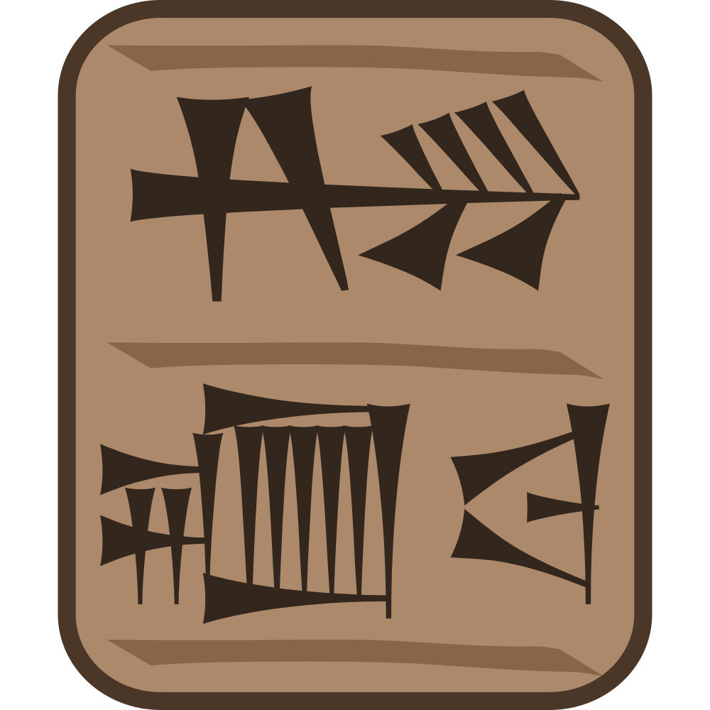
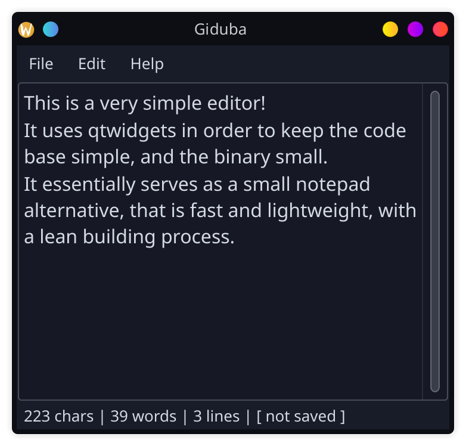
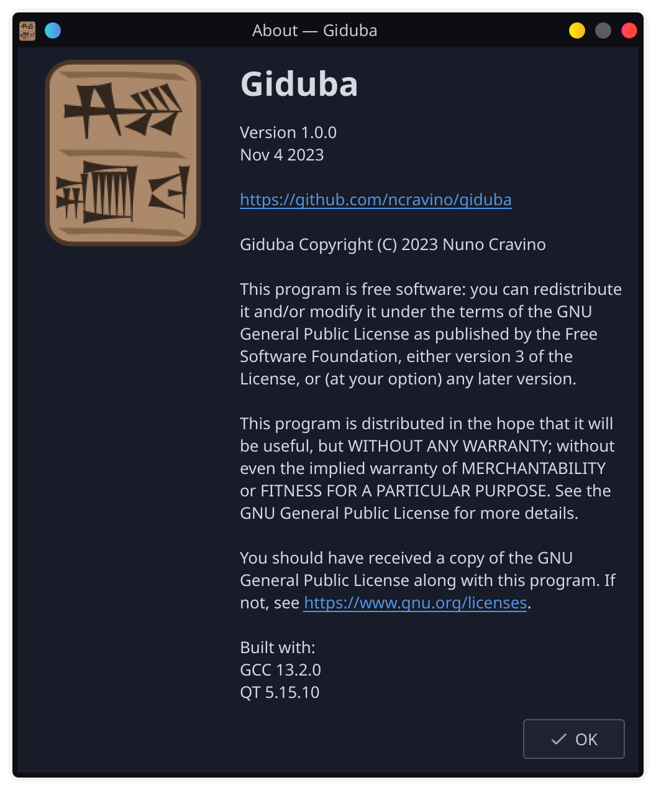

# Giduba


A lean, small, and simple text editor / notepad alternative in QT.

The goal of this editor is to be a very simple and fast text editor for quick text editing tasks such as viewing/changing config files, paste buffering, etc.

This code is licensed under the GNU Public License Version 3, see [LICENSE](./LICENSE) for details.

This is not a code editor.

Giduba is the sumerian word for writing utensils, literally a reed that was cut and used to write cuneiform on a clay tablet.

## Features

- Configurable via `~/.config/giduba/`
- Read unicode files
- Write UTF8
- Character, word, line counter
- Word Wrapping
- Search and Replace
- Fast and Small (around 115KB in x86_64)
- Open file via argument
- Save last window geometry

## Installing

Flatpak coming...

## Building

### Requirements
- make 
- qt5-qmake 
- qtbase5-dev 
- build-essential

Under Debian based distributions use `make deb-install-build-depends`.

### Compiling Source

- `make build`

The binary will be under `./build/giduba`.

## Configuration

Configuration is done using the file `$HOME/.config/giduba/giduba.conf`.

### Default Configuration

The file will be created and filled with the default configuration on the first run.

```
[General]
font_size=12
max_file_size_mb=512
show_scroll_bars=true
wrap=true
```

### Configuration Keys

- `show_scroll_bars`:  a boolean that defines whether or not to always show the scroll bars (note that the horizontal will be hidden if wrap is true).
- `font_size`: an integer defining the default font size for the editor
- `wrap`: a boolean defining wether or not to wrap text (acording to window dimensions)
- `max_file_size_mb`: an integer to limit on the maximum file size that can be opened. In megabytes.

Any missing key will be replaced by the default.

## Screenshots


